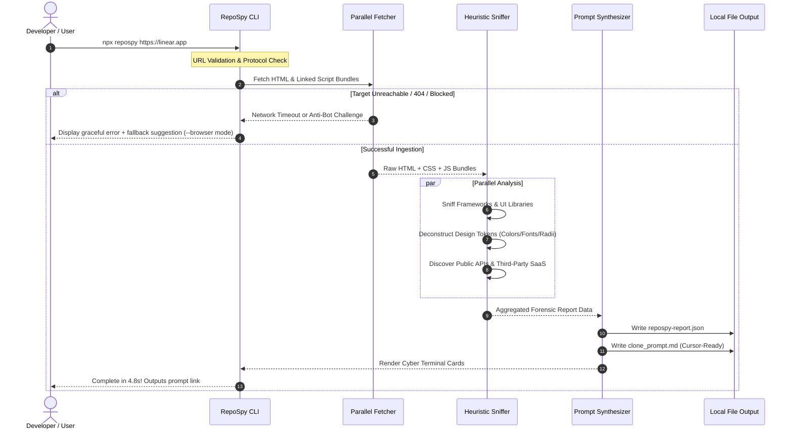

# 🔄 Pillar 3: Application Flow & Execution Logic (APP_FLOW) — RepoSpy

## 1. End-to-End Execution Flow

---

## 2. Mandatory Error, Edge-Case & Fallback States

| Error Condition | Trigger Scenario | Automated CLI Response |
| :--- | :--- | :--- |
| **Invalid URL** | User inputs `linear` instead of `https://linear.app`. | Auto-prepends `https://` and tests connectivity before erroring. |
| **Cloudflare CAPTCHA / 403** | Target site enforces strict Cloudflare Bot Management. | Switches User-Agent to standard modern Chrome desktop; if still blocked, provides clear manual copy-paste instructions for the HTML. |
| **Single-Page App (SPA) Empty Root** | Target app renders purely via client-side JS with blank initial HTML. | Scans referenced script tags and webpack manifests directly to extract bundle identifiers and state stores. |
| **Timeout (>10s)** | Slow target server or massive 50MB bundle payload. | Gracefully halts further chunk downloads, operates on gathered primary assets, and flags `"Partial Scan Completed"`. |
